# La Despensa

E-commerce gastronómico desarrollado con WordPress y WooCommerce.

Tienda ficticia de productos chilenos: aceites y condimentos, mermeladas y
conservas, café y té, productos artesanales, panadería y repostería.
Moneda CLP, idioma español, mercado Chile.

## Ficha del proyecto

| | |
|---|---|
| Tipo | Tienda e-commerce de demostración |
| Rol | Diseño, desarrollo, infraestructura y pruebas |
| Stack | WordPress, WooCommerce, PHP, MariaDB, Docker |
| Estado | Demo local funcional |
| Código | MIT |
| Fotografías | Unsplash License |
| Tipografías | SIL Open Font License |

## Vista general

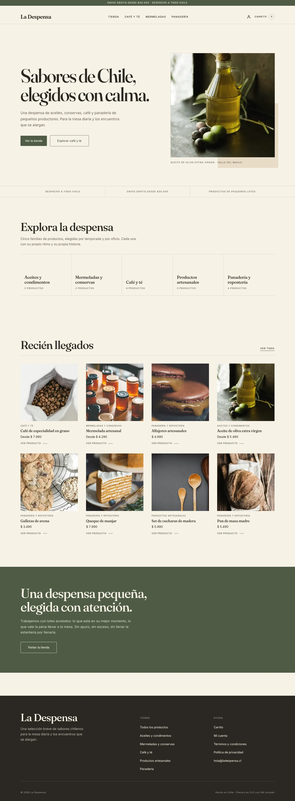

## Qué demuestra

- Infraestructura reproducible con Docker Compose, MariaDB y WP-CLI.
- Catálogo con productos simples, variables, atributos, stock e imágenes.
- Configuración regional chilena: CLP, IVA incluido y envío nacional.
- Cupones, métodos de pago de prueba y correos transaccionales locales.
- Checkout por bloques con campo RUT validado en servidor.
- Tema hijo propio, mobile first y sin frameworks CSS externos.
- Personalizaciones PHP mediante hooks y filtros.
- Optimización de imágenes WebP, `srcset`, `sizes` y precarga del hero.

## Capturas

| Escritorio | Móvil |
|:---:|:---:|
|  | 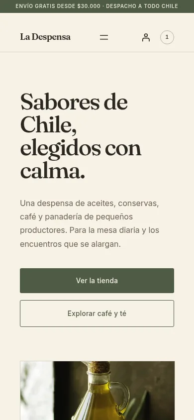 |
| 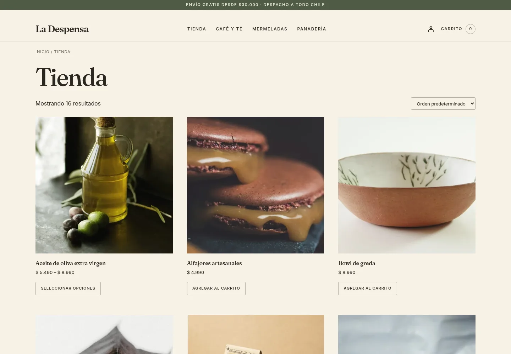 | 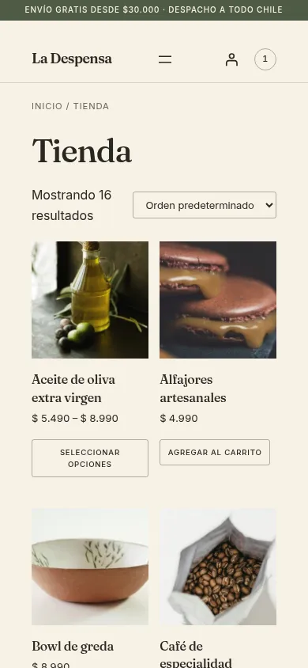 |
| 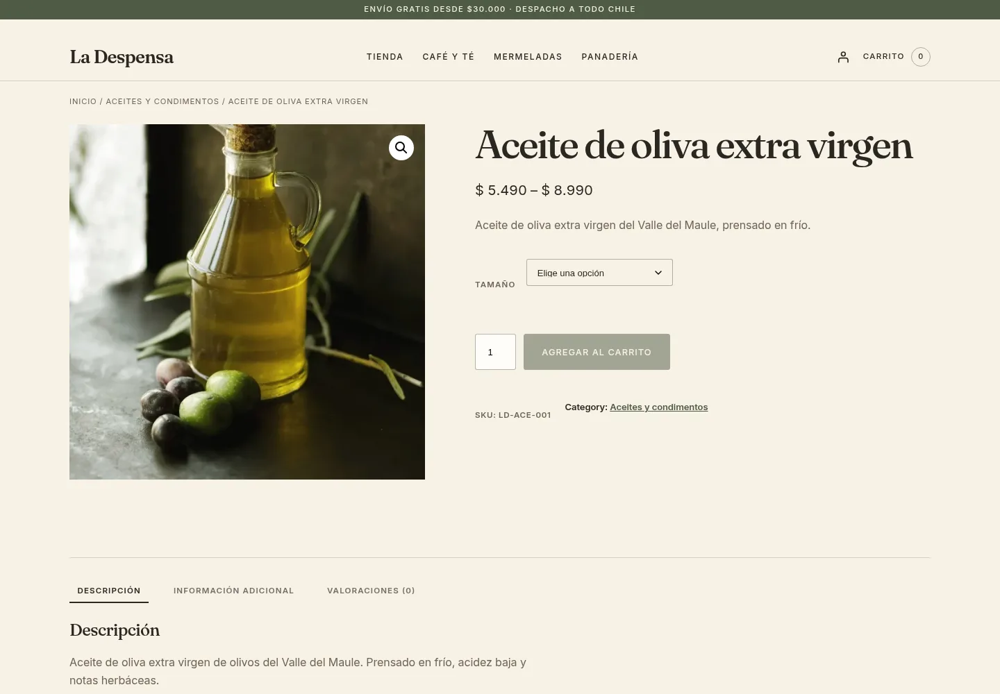 | 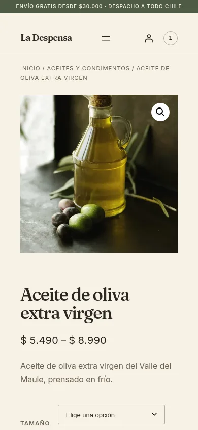 |
| 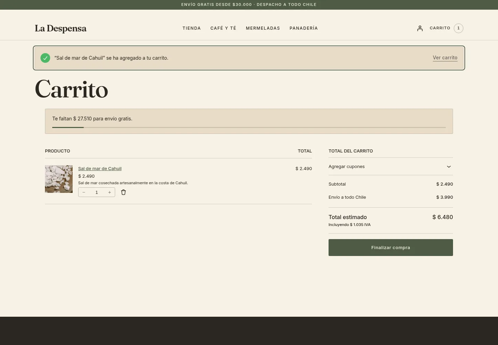 | 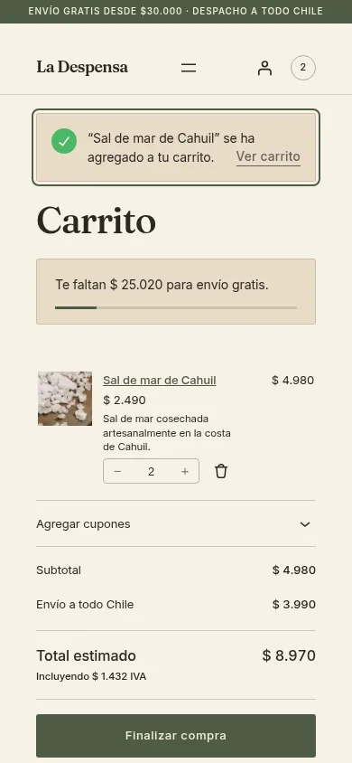 |
| 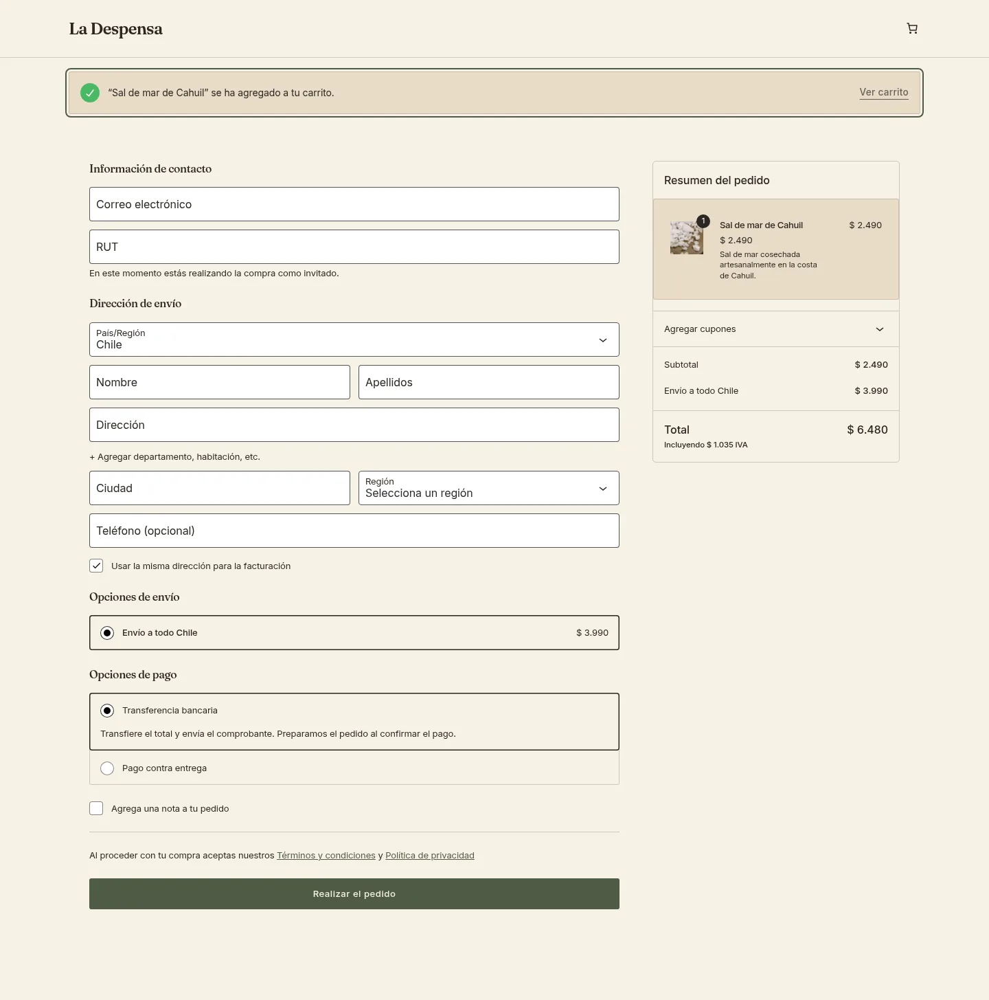 | 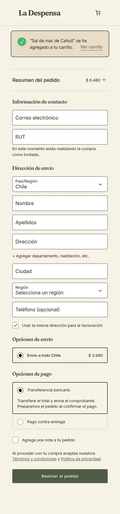 |

### Pedido y administración

| Confirmación | Admin del pedido |
|:---:|:---:|
| 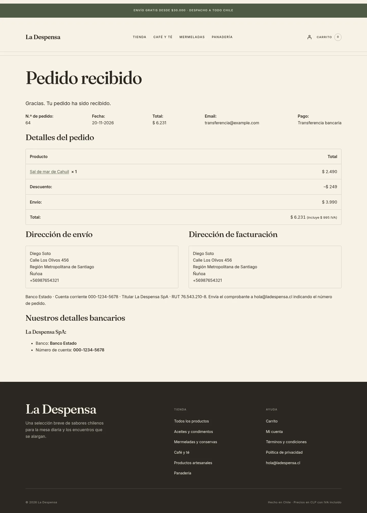 | 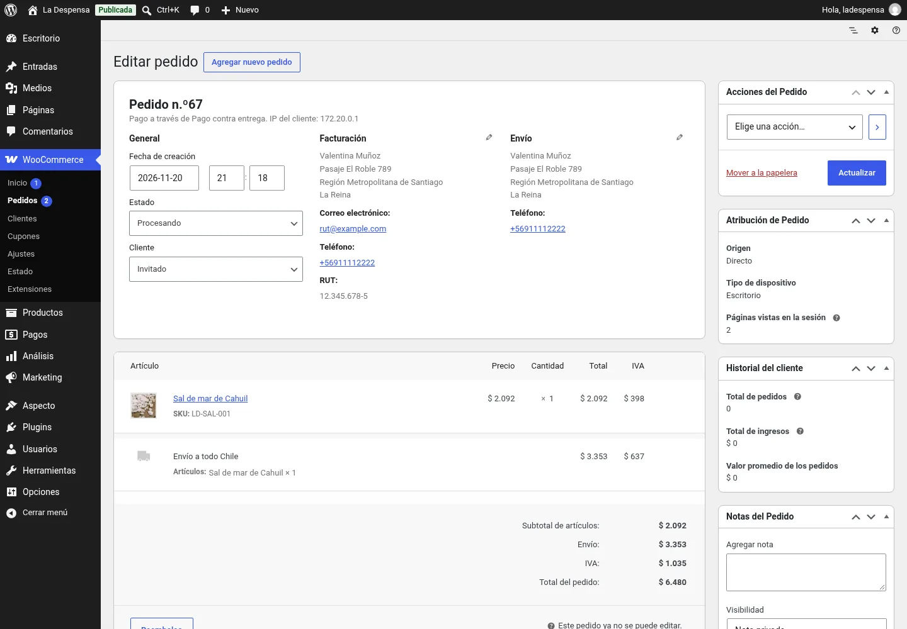 |

### Correos transaccionales

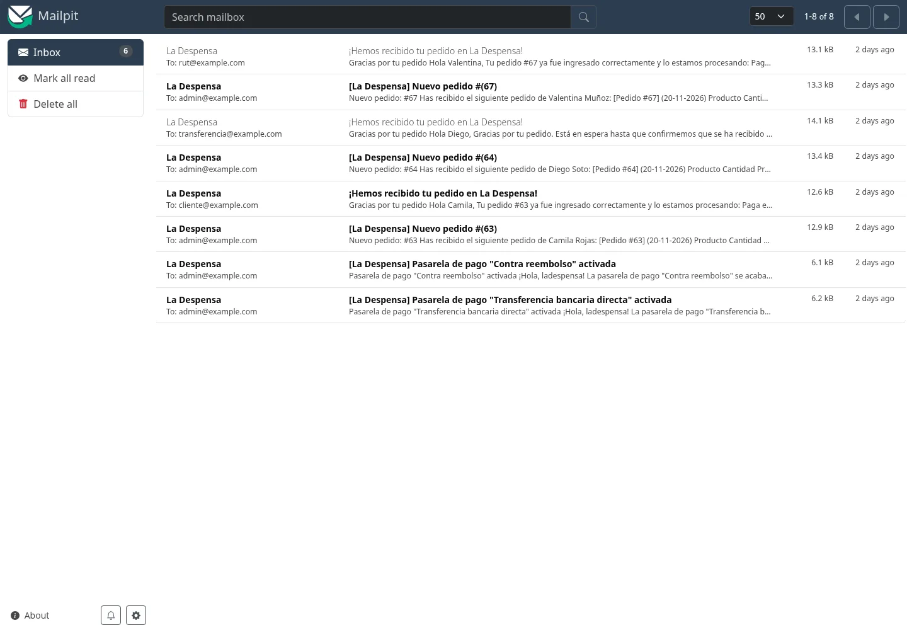

## Recorrido de compra

1. El cliente entra a la tienda y elige un producto simple o variable.
2. Agrega al carrito; el contador del header se actualiza sin recargar.
3. El carrito muestra el aviso de envío gratis y su barra de progreso.
4. En checkout completa sus datos, RUT y dirección.
5. Elige transferencia bancaria o pago contra entrega.
6. Al confirmar, WooCommerce crea el pedido, descuenta stock y envía correos.
7. El pedido queda `on-hold` para transferencia o `processing` para contra
   entrega.

## Stack

- WordPress 7.1.5.
- WooCommerce 11.3.1.
- PHP 8.4 sobre Apache.
- MariaDB 11.8 LTS.
- Docker Compose.
- WP-CLI.
- Tema hijo de Twenty Twenty-Five.
- HTML, CSS y JavaScript sin framework.

## Funcionalidades

### Infraestructura

- Servicios `db`, `wordpress`, `wpcli` y `mailpit`.
- Volúmenes para base de datos, core y Mailpit.
- `wp-content` en bind mount para edición y control de versiones.
- Imagen de WordPress con UID/GID del host para evitar problemas de permisos.
- Configuración idempotente con `make init`, `make tema`, `make woocommerce`,
  `make catalogo` y `make checkout`.

### WooCommerce

- País Chile, venta y envío solo a Chile.
- CLP sin decimales, formato `$ 1.990`.
- IVA 19% incluido en precios y aplicado al envío.
- Zona de envío Chile con tarifa plana y envío gratis desde $30.000.
- 16 productos: 13 simples y 3 variables.
- 5 categorías, atributos globales Tamaño y Sabor, stock y SKU.
- Cupones `BIENVENIDA10`, `DESCUENTO2000` y `ENVIOGRATIS`.
- Transferencia bancaria y pago contra entrega.

### Diseño

- Paleta crema, arena, oliva, terracota y carbón.
- Fraunces para títulos, Inter para texto, precios y botones.
- Fuentes self-hosted, sin Google Fonts en tiempo de ejecución.
- Portada, tienda, ficha, carrito, checkout, cuenta y 404 propias.
- Header fijo, menú móvil y cuenta de usuario.
- Breakpoints revisados en 360, 390, 768, 1024 y 1440 px.

### Personalización

- RUT obligatorio en checkout, normalizado y validado con módulo 11.
- Campo registrado con `woocommerce_register_additional_checkout_field`.
- El RUT queda en el pedido y se ve en confirmación, admin y correos.
- Aviso de envío gratis con AJAX al cambiar cantidades.
- Al calificar, se elimina la tarifa plana y queda solo envío gratis.
- Bloques dinámicos del tema para categorías, destacados, hero y carrito.
- Contador de carrito actualizado tras agregar o quitar productos.

### Correos

- Mailpit en http://localhost:8025 captura todos los correos.
- Mu-plugin `dev-mailpit.php` desvía PHPMailer a SMTP local.
- Correos de pedido nuevo y confirmación al cliente.
- Sin envío a direcciones reales en desarrollo.

## Arquitectura

```
.
├── docker-compose.yml
├── docker/
│   ├── wordpress/Dockerfile
│   └── php/uploads.ini
├── scripts/
│   ├── init-wordpress.sh
│   ├── configure-woocommerce.php
│   ├── configure-checkout.php
│   ├── seed-catalogo.php
│   └── generar-placeholders.sh
├── assets/productos/              Fuentes WebP y créditos
├── docs/capturas/                 Capturas del portafolio
├── wp-content/
│   ├── themes/la-despensa/
│   │   ├── inc/checkout.php
│   │   ├── assets/fonts/
│   │   ├── assets/js/
│   │   ├── parts/
│   │   ├── templates/
│   │   ├── functions.php
│   │   ├── style.css
│   │   └── theme.json
│   ├── mu-plugins/dev-mailpit.php
│   └── uploads/                   Ignorado por Git
├── backups/                       Ignorado por Git
├── Makefile
├── LICENSE
└── .env.example
```

Volúmenes:

- `db_data`: MariaDB.
- `wp_data`: core de WordPress y `wp-config.php`.
- `mailpit_data`: mensajes de correo locales.

## Decisiones técnicas

- **Docker desde el host:** no se instala PHP, Composer ni WP-CLI en la máquina.
- **Imagen propia de WordPress:** `www-data` usa el UID/GID del host para que
  uploads y archivos del tema sean editables sin `sudo`.
- **Core en volumen, `wp-content` en bind mount:** el repositorio versiona solo
  lo propio del proyecto.
- **WooCommerce como único plugin:** se instala con WP-CLI y no se versiona.
- **Envío con IVA:** WooCommerce ingresa costos de envío netos. La tarifa se
  guarda en $3.353 para que el cliente pague $3.990 final.
- **Checkout por bloques:** el RUT usa la API moderna de campos adicionales,
  no `woocommerce_checkout_fields`.
- **WebP directo:** sin plugin de optimización; WordPress genera los tamaños
  derivados y el navegador elige con `srcset` y `sizes`.
- **Hero precargado:** `link rel="preload"` con `imagesrcset` reduce el LCP.
- **Correo local:** PHPMailer se intercepta por hook, sin plugin SMTP.

## Cómo ejecutar

Requisitos:

- Docker Engine y Docker Compose v2 o superior.
- Git.
- Puerto 8080 libre.

```bash
cp .env.example .env
# Edita .env con contraseñas propias
make up
make init
make tema
make woocommerce
make catalogo
make checkout
```

Accesos:

```
Sitio:    http://localhost:8080
Panel:    http://localhost:8080/wp-admin
Mailpit:  http://localhost:8025
```

El usuario y la contraseña del admin están en `.env`
(`WP_ADMIN_USER`, `WP_ADMIN_PASSWORD`). `.env` no se versiona.

## Comandos

```bash
make help
make ps
make logs
make wp ARGS="plugin list"
make shell
make db-dump
make checkout
make mail
make reset
```

`make reset` elimina contenedores y volúmenes. Pide confirmación escrita.

## Datos demo

- Pedido 63: pago contra entrega, $6.480.
- Pedido 64: transferencia bancaria con cupón, $6.231.
- Pedido 67: pago contra entrega con RUT, $6.480.
- Los pedidos tienen una nota interna que los identifica como demostración.
- Stock de Sal de mar: 27 unidades.
- Mailpit conserva los correos de prueba.

## Pruebas realizadas

| Área | Resultado |
|---|---|
| Catálogo | 16 productos, 7 variaciones, 5 categorías |
| Imágenes | 16 fotos WebP y 80 tamaños derivados |
| Peso | Portada 451 KB, tienda 555 KB |
| Precios e IVA | CLP sin decimales, IVA 19% incluido |
| Stock | Descontado por pedido |
| Cupones | 10%, monto fijo y envío gratis |
| Envío | Tarifa plana y gratis desde $30.000 |
| Checkout | RUT validado, pagos y términos |
| Pagos | Transferencia y contra entrega |
| Correos | 8 mensajes en Mailpit |
| Legal | Privacidad, términos y devoluciones |
| Enlaces internos | 43 revisados, sin errores 4xx |
| Responsive | 360, 390, 768, 1024 y 1440 sin overflow |
| Teclado | Menú móvil abre con Enter y cierra con Escape |
| 404 | Página propia publicada |
| Respaldo | SQL con 48 tablas |
| Consola | Sin errores JavaScript |
| `debug.log` | Sin errores ni avisos |
| LCP local | 904 ms portada, 956 ms tienda |

## Limitaciones

- Fotografías de Unsplash; no representan exactamente los productos ficticios.
- Pagos de prueba: no hay Webpay, Mercado Pago ni pasarela real.
- Mailpit no entrega correos a direcciones reales.
- Sin integración con transportistas ni cálculo por comuna.
- `blog_public=0`: el sitio no se indexa.
- No se validó una instalación desde cero en esta máquina.

## Licencias

- Código del proyecto: MIT, ver `LICENSE`.
- Fotografías: Unsplash License, créditos en
  `assets/productos/CREDITS.md`.
- Fraunces e Inter: SIL Open Font License, archivos en
  `wp-content/themes/la-despensa/assets/fonts/`.
- WordPress y WooCommerce: GPL.
- La marca, los productos y los textos de La Despensa son ficticios.

## Etapas

0. Infraestructura, WordPress base y Git.
1. Configuración de WordPress y limpieza de contenido demo.
2. WooCommerce y configuración regional.
3. Catálogo de productos.
4. Tema hijo e identidad visual.
5. Flujo de compra, pagos y correos.
6. Personalización PHP de checkout y carrito.
7. Pruebas, optimización y portafolio.
